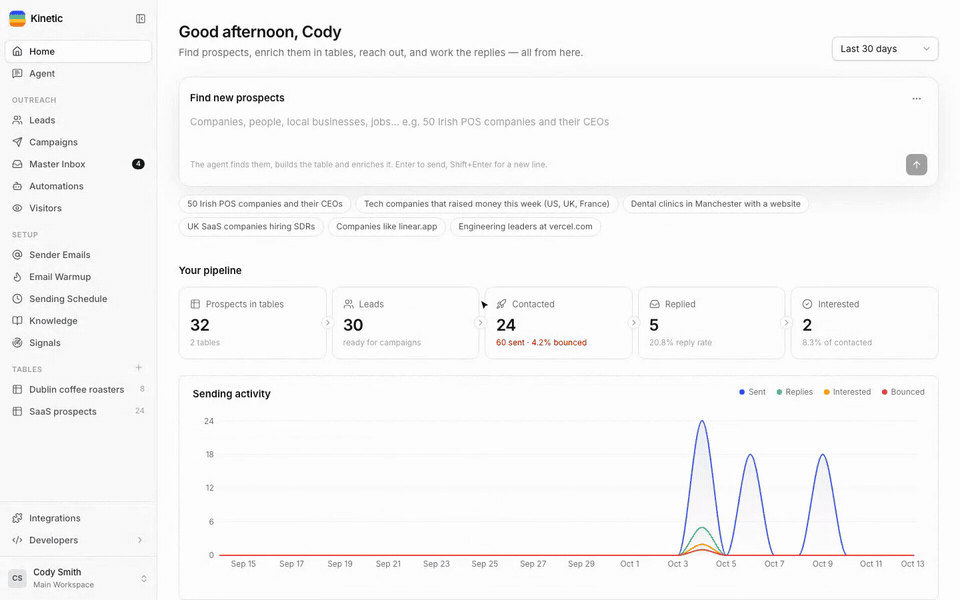
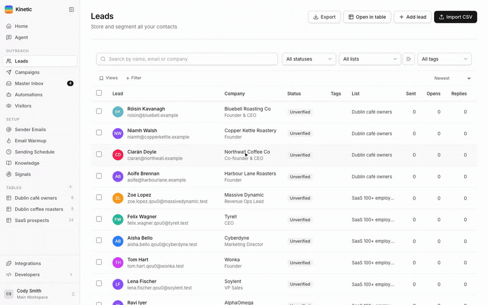
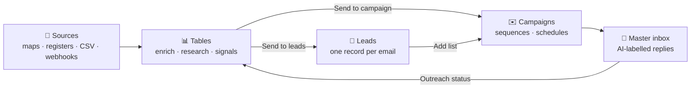
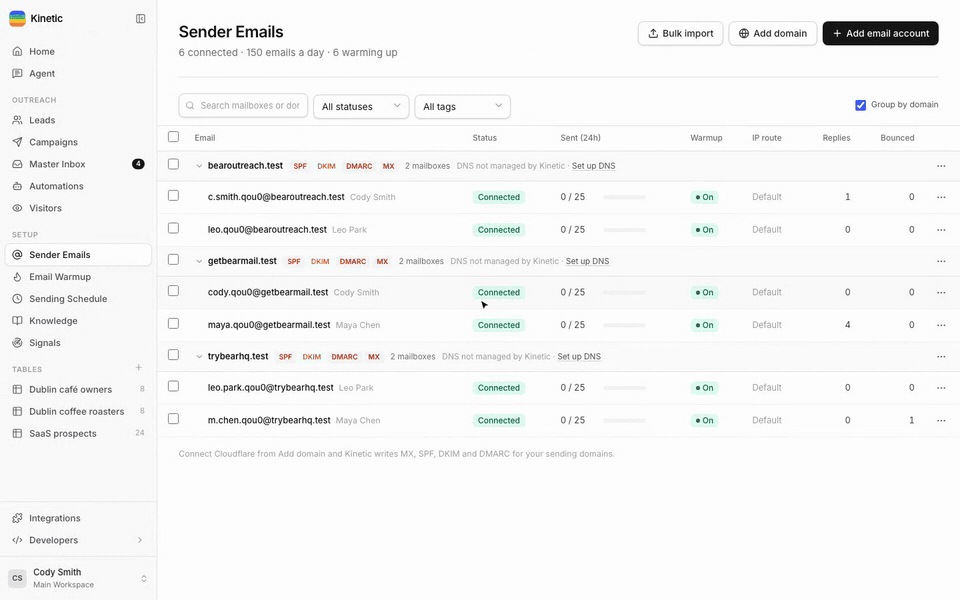
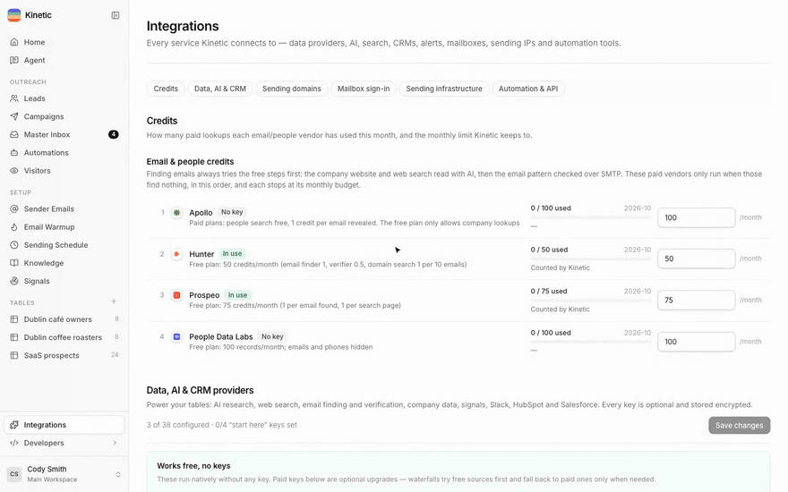

<div align="center">


# Kinetic

**Find prospects, enrich them, and email them — from one self-hosted app.**

Spreadsheet-style tables with waterfall enrichment, AI research and buying signals,<br/>
wired straight into cold email: campaigns, warmup, a master inbox and an AI agent that runs it all.

<p>
  <a href="LICENSE"></a>
  <a href="CONTRIBUTING.md"></a>
  
  
  
  
  
  
</p>

[Quick start](#-quick-start) ·
[Agent](#-the-agent) ·
[Tables](#-tables) ·
[Outreach](#-leads-campaigns-and-the-master-inbox) ·
[Deliverability](#-mailboxes-warmup-and-deliverability) ·
[Integrations](#-integrations) ·
[API](#-api-webhooks-and-automation) ·
[Deploy](#-running-it-for-real) ·
[Contributing](#-contributing)

<br/>

https://github.com/user-attachments/assets/9dcc8de9-3f0a-4a84-b3cc-3dc66fea389c

<sub>Ask the agent for a prospect list: it builds the table, adds an AI research column and runs it. All data in these clips is fictional.</sub>

</div>

<br/>

## Why Kinetic

Outbound usually means five subscriptions glued together: a data tool for lists, an enrichment tool for emails, a sequencer for sending, a warmup service for deliverability and a CRM-ish inbox for replies. Every hand-off is a CSV export.

Kinetic is all of it in **one process and one SQLite file** you own:

|  |  |
|---|---|
| 🔎 **Find** | Free sources first: Google Maps / OpenStreetMap, YC directory, GitHub orgs, job boards, SEC Form D and UK Companies House (recently funded companies), lookalikes, CSV, webhooks — or just ask the agent. |
| 🧪 **Enrich** | Waterfalls that try **free steps first** (company website + web search read with AI, email patterns checked over SMTP) and only spend paid credits (Apollo, Hunter, Prospeo, People Data Labs…) when they have to — with monthly budgets per vendor. |
| 🧠 **Research** | AI columns that browse and return typed fields with sources. Any OpenRouter model, or a local model through Ollama / LM Studio. |
| 📡 **Watch** | Signals for hiring, funding, news, SEC filings, tech-stack and page changes, new subdomains and job changes — with Slack and webhook alerts. |
| ✉️ **Reach out** | Multi-step A/B sequences with spintax and variables, per-mailbox limits, timezone windows, open/click tracking and one-click unsubscribe. |
| 🔥 **Land in the inbox** | Private warmup pool, inbox placement tests, SPF/DKIM/DMARC checks and Cloudflare DNS setup for new sending domains. |
| 💬 **Work replies** | A master inbox across every mailbox, with AI labels (interested, meeting, objection, out of office…) flowing back into your tables. |
| 🛡️ **Stay compliant** | Every lead records where its email came from, unsubscribes are permanent across re-imports, and blacklists apply everywhere. |

<br/>

## 🚀 Quick start

You need **Node.js 24+**. That's it — no Postgres, no Redis, no Docker.

```bash
git clone https://github.com/tashfeenahmed/kinetic.git
cd kinetic
npm install
npm run build        # builds the web app
npm start            # UI + API on http://localhost:4200
```

Open **http://localhost:4200** and create your admin account. Everything lives in `./data` (SQLite database, attachments, encryption key) — back that folder up.

<details>
<summary><b>Try it with demo data</b></summary>

Needs Docker for a local test mail server. It runs real campaigns through it with simulated time: ~10 days of sending, replies of every kind, a bounce and warmup traffic.

```bash
npm run mail:up
DATA_DIR=./demo-data npm run demo
DATA_DIR=./demo-data npm start     # log in as demo@kinetic.test / demo-password
```
</details>

<details>
<summary><b>Development</b></summary>

```bash
npm run dev          # API with reload + Vite on http://localhost:5273
npm test             # unit + API tests, incl. tables ⇄ outreach end-to-end
npm run typecheck
npm run mail:up && npm run test:mail   # real SMTP/IMAP tests against GreenMail
```
</details>

<br/>

## 🤖 The agent

A chat that can do anything you can do in the app — through the same API, with your permissions. It loads playbooks ("skills") for each job, reads your Knowledge Hub (offer, ICP, personas, tone) and asks before anything that sends, deletes or spends.

- **Pick any model.** Every tool-capable model on OpenRouter (Claude, GPT, Gemini, Llama, Qwen, free models…) or a local model via `AI_BASE_URL`.
- **Builds whole workflows.** "Find 50 Irish POS companies and their CEOs" → a table, the right enrichments, verified emails and a campaign draft.
- **Approvals built in.** Launching campaigns, sending, deleting and paid enrichment over ~100 rows pause for your click.
- **Your own skills.** Write playbooks in Markdown; the agent uses them like the built-in ones.

<br/>

## 📊 Tables

<div align="center">
<a href="docs/media/video/tables.mp4"></a>
</div>

Spreadsheets whose columns do work. Start from a template, import a CSV, POST rows to the table's webhook, or let the agent build one.

| Column | What it does |
|---|---|
| **Enrichment** | Waterfalls across providers, free steps first: work email, verification, decision makers, company profile, LinkedIn, phone, domains. Each cell shows which provider answered. |
| **AI research** | An agent per row that searches, reads pages and returns typed fields (with sources). |
| **Signal** | Hiring, news, funding, SEC, tech stack, page changes, GitHub, Outreach status — with "changed in the last 7 days" markers. |
| **Formula / Extract / HTTP** | JavaScript over the row, pull a field out of a result, call any API. |
| **Action** | Send to a campaign or lead list, Slack, webhooks, HubSpot, Salesforce. |
| **Function** | Reusable recipes — save a set of columns once, add them to any table. |

Filter and sort any column, select rows to **run**, **export**, **delete** or **send** them, schedule re-runs, and let columns auto-run when their inputs change.

<br/>

## 📨 Leads, campaigns and the master inbox

<div align="center">
<a href="docs/media/video/outreach.mp4"></a>
</div>

Data flows one way and stays consistent:



- **Leads** — one record per email across every table and campaign: status, lists, tags, custom variables, full email history and **where the email came from**. Unsubscribes and bounces are permanent.
- **Campaigns** — multi-step sequences with A/B variants, spintax and `{VARIABLES}` from any table column (an AI "icebreaker" column becomes `{ICEBREAKER}`), per-mailbox limits and timezone windows.
- **Master inbox** — every reply from every mailbox, labelled by AI, with reply templates and drafts.

<br/>

## 🔥 Mailboxes, warmup and deliverability

<div align="center">
<a href="docs/media/video/warmup.mp4"></a>
</div>

- **Any mailbox** — Google (OAuth or app password), Microsoft 365 (OAuth) or any IMAP/SMTP account.
- **Private warmup pool** — your mailboxes email each other, get opened, replied to and rescued from spam; health and inbox-vs-spam per mailbox.
- **Inbox placement tests** — send to seed inboxes at Gmail, Outlook and Yahoo and see where you land.
- **Domains on autopilot** — connect Cloudflare and Kinetic writes MX, SPF (merged, never duplicated), DKIM, DMARC and tracking records, then verifies them.
- **Sending IPs** — pin mailboxes to fixed IPs or proxies.

<br/>

## 🔌 Integrations

<div align="center">
<a href="docs/media/video/integrations.mp4"></a>
</div>

Every key is optional and stored encrypted. Kinetic works with **no paid keys at all** and gets better with each one you add.

| Area | Providers |
|---|---|
| **AI** | OpenRouter (300+ models), any OpenAI-compatible endpoint (Ollama, LM Studio) |
| **Search & scraping** | SearXNG (self-hosted, free), Serper, Brave, Tavily, Exa, Jina Reader, scraping proxy |
| **Email finding & verification** | Built-in pattern + SMTP finder, Hunter, Prospeo, Findymail, Icypeas, LeadMagic, MillionVerifier, ZeroBounce |
| **Company & people data** | Apollo, People Data Labs, Google Maps, GitHub, UK Companies House (incl. streaming), SEC EDGAR, Cert Spotter |
| **Infrastructure** | Cloudflare DNS, Google & Microsoft OAuth apps, IPinfo |
| **CRM & alerts** | HubSpot, Salesforce, Slack |
| **Automation** | REST API, 17 signed webhook events, n8n, Make, Zapier |

**Credits panel** — see what each paid vendor used this month, its live balance, and set a monthly budget; waterfalls skip a vendor once its budget is spent.

<br/>

## 🧩 API, webhooks and automation

- **REST API** — 385 routes covering everything the UI does. OpenAPI spec at `/api/openapi.json`, interactive reference at `/api/reference`. Workspace-scoped API tokens.
- **Webhooks** — 17 signed events (sent, opened, replied, interested, bounced, unsubscribed, signal changed…) with retries.
- **Automations** — triggers and actions inside Kinetic, plus n8n / Make / Zapier recipes.
- **Kinetic Companion** — a browser extension that runs LinkedIn, Instagram, X and Facebook steps inside your own logged-in browser, at a human pace.

<br/>

## 🏗️ Under the hood

```
server/src/            Fastify + node:sqlite (TypeScript runs natively on Node 24)
  engine/ mail/ routes/   outreach: sequencer, inbox sync, warmup, placement, webhooks, API
  gtm/                    tables: engine (queue, cascades, scheduler), providers, AI agent, outreach bridge
  agent/                  the chat agent: tools, approvals, skills (Markdown playbooks)
  sourcing/               lead sources: maps, registers, funding rounds, job boards…
web/src/               React + Vite + Tailwind; gtm/ holds the tables UI (Handsontable)
extension/             Kinetic Companion (Chrome, MV3)
```

One process runs the web server, the outreach worker and the tables engine. `WORKERS=off` runs the UI and API only.

<br/>

## 🌍 Running it for real

1. Set `PUBLIC_URL` to an address recipients can reach — tracking, unsubscribe links, OAuth callbacks and inbound webhooks use it. A free Cloudflare Tunnel works well.
2. Put it behind HTTPS and run it under a process manager (`pm2`, systemd).
3. Back up `DATA_DIR`.

It is light enough for a **Raspberry Pi 5**: deploy with `npm ci && npm run build && npm start`.

Configuration lives in `.env` (see [`.env.example`](.env.example)); every provider key can also be set from the Integrations page.

<br/>

## 📚 More

- [`docs/RESEARCH.md`](docs/RESEARCH.md) — provider pricing and what each one is good for
- [`docs/FREE_ALTERNATIVES.md`](docs/FREE_ALTERNATIVES.md) — free and open sources for every paid data feed

<br/>

## 🤝 Contributing

Kinetic is open source and contributions are welcome: bug reports, docs, new lead sources, enrichment providers, signals, agent skills and UI polish. Read [CONTRIBUTING.md](CONTRIBUTING.md) to get set up, then open an issue or a pull request.

## 📄 License

[MIT](LICENSE) — use it, change it, ship it.

<div align="center">
<br/>
<sub>Built with Fastify, React, Handsontable and SQLite. Demo clips use fictional companies and people.</sub>
</div>
